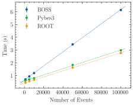

# Documentation for Pybes3

Pybes3 is a Python module that aims to make it easier for BES3 users to work with Python.

:::{admonition} Help us improve Pybes3!
:class: note

If you have any suggestions, questions, or issues, please feel free to
[open an issue](https://github.com/mrzimu/pybes3/issues/new/choose).
:::

:::{admonition} See Also
:class: tip

It is highly recommended to take a look at these Python modules before using Pybes3:

- [`awkward`](https://awkward-array.org/doc/stable/index.html): A Python module that can handle ragged-like array.
- [`uproot`](https://uproot.readthedocs.io/en/stable/): A ROOT I/O Python module. Pybes3 uses `uproot` to read BES3 ROOT files.
:::

::::{grid} 1 2 2 2
:gutter: 3

:::{grid-item-card} Install Pybes3 using `pip`
:link: installation
:link-type: doc

Get Pybes3 from PyPI.
:::

:::{grid-item-card} Get started with user manual
:link: user-manual/data-reading
:link-type: doc

Learn how to read data and use detector utilities.
:::
::::

## User manual

::::{grid} 1 2 2 2
:gutter: 3

:::{grid-item-card} Data reading
:link: user-manual/data-reading
:link-type: doc

Read `rtraw`, `rec`, `dst`, and even `raw` files.
:::

:::{grid-item-card} Global ID (gid)
:link: convention/gid
:link-type: doc

Zero-based global ID (gid) for detector elements in Pybes3.
:::

:::{grid-item-card} BOSS identifier
:link: user-manual/identifier
:link-type: doc

Convert BOSS detector identifier number to a human-readable format.
:::

:::{grid-item-card} Helix operations
:link: user-manual/helix
:link-type: doc

Parse and transform helix parameters.
:::
::::

## Performance

Pybes3 is designed to be fast and efficient. It uses C++ to accelerate some of the operations, such as helix operations, detector identifier conversion, etc.

### Data reading

The benchmark compares three readers on identical work: the seven Dst collections of every event are decoded and nothing is written back. The other branches of the `Event` tree (`TEvtHeader`, `TTrigEvent`, `TEvtRecObject`, `THltEvent`) are not read.

All readers read the same sub-branches of `TDstEvent`:

| Branch                       | Collection          |
| :--------------------------- | :------------------ |
| `TDstEvent/m_mdcTrackCol`    | `DstMdcTrackCol`    |
| `TDstEvent/m_mdcKalTrackCol` | `DstMdcKalTrackCol` |
| `TDstEvent/m_mdcDedxCol`     | `DstMdcDedxCol`     |
| `TDstEvent/m_extTrackCol`    | `DstExtTrackCol`    |
| `TDstEvent/m_tofTrackCol`    | `DstTofTrackCol`    |
| `TDstEvent/m_emcTrackCol`    | `DstEmcShowerCol`   |
| `TDstEvent/m_mucTrackCol`    | `DstMucTrackCol`    |

- Pybes3 reads those sub-branches with `uproot`:

    ```python
    import uproot
    import pybes3

    n_evt = ...  # number of events to read
    files = [...]  # list of ROOT files to read
    branches = [
        "TDstEvent/m_mdcTrackCol",
        "TDstEvent/m_mdcKalTrackCol",
        "TDstEvent/m_mdcDedxCol",
        "TDstEvent/m_extTrackCol",
        "TDstEvent/m_tofTrackCol",
        "TDstEvent/m_emcTrackCol",
        "TDstEvent/m_mucTrackCol",
    ]

    data = uproot.concatenate({f: "Event" for f in files}, expressions=branches, entry_stop=n_evt)
    ```

- A plain `ROOT` C++ program opens the same file, points a branch address at the `TDstEvent` object, enables the same sub-branches and loops over `TTree::GetEntry`. This is the fastest reading available without an experiment framework.

- A `BOSS8` job loops over all events and reads the same collections through the transient data store, so each collection is first converted from its ROOT representation into data-store objects by the Gaudi converters.

Each point is measured with `hyperfine`, using two warm-up runs and five measured runs, for `1000`, `5000`, `10000`, `50000` and `100000` events.

The benchmark machine is an `AMD EPYC 9654` (96 cores) and the input file is `/bes3fs/offline/data/712-1/psipp/round17/dst/231029/run_0078615_All_file001_SFO-1.dst`.

The results are shown below:

<div align="center">
    <picture>
        <source srcset="_static/image/io-benchmarking-dark.svg" media="(prefers-color-scheme: dark)">
        
    </picture>
</div>

Fitting the reading time with `t = a + b * N` separates the fixed start-up cost from the per-event cost:

| Reader       | Start-up time (ms) | Time per event (µs) |
| :----------- | -----------------: | ------------------: |
| `BOSS8`      | 658                | 55.2                |
| Plain `ROOT` | 429                | 23.6                |
| Pybes3       | 566                | 24.3                |

`BOSS8` pays 55.2 µs per event, more than twice what the other readers pay, because the Gaudi converters rebuild every collection in the transient data store. The file is read once in all cases; the extra time is the conversion, not the I/O.

Pybes3 is almost on top of plain `ROOT` at 24.3 µs per event against 23.6 µs. The few percent in between is the cost of building the awkward arrays on top of the decoded data, while the decoding itself costs no more than the generic ROOT object streamer, since the C++ kernels are generated for the BES3 event layout.

Start-up goes the other way: Pybes3 spends 566 ms before the first event against 429 ms for plain `ROOT`, mostly importing the module and loading its kernels, and 658 ms for `BOSS8`, which also configures the event loop and the persistency services. Start-up is paid once per job, so the per-event column decides long jobs and this column decides short ones; either way Pybes3 is twice as cheap per event as `BOSS8` and within a few percent of plain `ROOT`.

:::{toctree}
:hidden:
:maxdepth: 2

installation
:::

:::{toctree}
:hidden:
:caption: Convention
:maxdepth: 1

convention/unit
convention/gid
:::

:::{toctree}
:hidden:
:caption: User manual
:maxdepth: 1

user-manual/data-reading
user-manual/mc
user-manual/mdc
user-manual/tof
user-manual/emc
user-manual/muc
user-manual/cgem
user-manual/helix
user-manual/identifier
:::

:::{toctree}
:hidden:
:caption: API Reference
:maxdepth: 1

api/pybes3
api/pybes3.io
api/pybes3.mdc
api/pybes3.tof
api/pybes3.emc
api/pybes3.muc
api/pybes3.cgem
api/pybes3.helix
api/pybes3.identifier
api/pybes3.digi_id
api/pybes3.mc
:::
